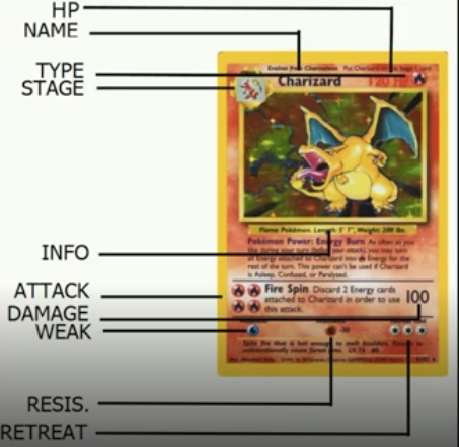
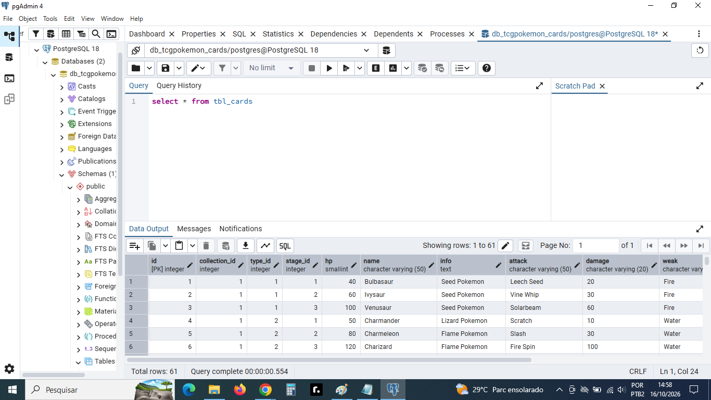

# 🃏 Pokémon Card Database — PostgreSQL

## 📌 Sobre o projeto

Este projeto foi desenvolvido como parte de um **Bootcamp da DIO em parceria com o Santander**, representando meus primeiros passos práticos no universo de bancos de dados relacionais e na linguagem SQL.

A proposta consiste em modelar um banco de dados para gerenciar cartas Pokémon, armazenando suas características, tipos, estágios de evolução, coleções e informações necessárias para organizar um acervo de cartas de um colecionador.

O projeto tem como objetivo aplicar conceitos fundamentais de modelagem de dados, criação de tabelas, relacionamentos e integridade dos dados, utilizando o PostgreSQL como sistema gerenciador de banco de dados e o pgAdmin como ferramenta de administração.

## 🎯 Objetivos do projeto

- 🗃️ Estruturar um banco de dados relacional para cartas Pokémon.
- 🧩 Organizar os diferentes tipos e estágios das cartas.
- 📚 Cadastrar coleções e suas respectivas datas de lançamento.
- ⚡ Armazenar características como nome, HP, ataques, dano, fraquezas, resistências e custo de recuo.
- 🔗 Estabelecer relacionamentos entre as tabelas.
- 🔐 Aplicar restrições para garantir a integridade dos dados.
- 💻 Desenvolver conhecimentos práticos em SQL e PostgreSQL.

## 🛠️ Tecnologias e ferramentas

| Tecnologia | Aplicação no projeto |
|---|---|
| PostgreSQL | Criação e gerenciamento do banco de dados relacional. |
| SQL | Definição da estrutura e inserção de dados. |
| pgAdmin | Interface gráfica para administrar o banco e executar scripts SQL. |
| Git e GitHub | Versionamento, organização e documentação do projeto. |

## 🗄️ Modelagem do banco de dados

A estrutura implementada nos scripts SQL está organizada em quatro tabelas principais:

| Tabela | Descrição |
|---|---|
| `tbl_types` | Armazena os tipos das cartas, como Grass, Fire, Water e Psychic. |
| `tbl_stages` | Registra os estágios das cartas, como Basic, Stage 1, Stage 2, V, VMAX e EX. |
| `tbl_collections` | Armazena o nome das coleções, a data de lançamento e a quantidade total de cartas. |
| `tbl_cards` | Armazena as cartas e suas características, relacionando-as aos tipos, estágios e coleções. |

### 🔗 Relacionamentos

A tabela `tbl_cards` utiliza chaves estrangeiras (`FOREIGN KEY`) para se relacionar com as tabelas de tipos, estágios e coleções.

Essa estrutura evita a repetição desnecessária de informações e permite organizar os dados de forma consistente.

Também foram aplicadas restrições como:

- `PRIMARY KEY`: identificação única dos registros.
- `FOREIGN KEY`: integridade dos relacionamentos entre tabelas.
- `NOT NULL`: definição de campos obrigatórios.
- `UNIQUE`: prevenção de valores duplicados em campos específicos.
- `CHECK`: validação de condições para determinados valores.
- `ON DELETE CASCADE`: exclusão das cartas vinculadas quando uma coleção é excluída.
- `CREATE UNIQUE INDEX`: garantia de unicidade da numeração de uma carta dentro de sua coleção.

## 🧪 Dados utilizados

Os scripts de carga inicial incluem exemplos de tipos, estágios de evolução, coleções e cartas conhecidas do universo Pokémon.

Entre as coleções cadastradas estão:

- Base Set
- Jungle
- Fossil
- Team Rocket
- 151
- Neo Genesis
- Expedition Base Set
- Hidden Fates
- Crown Zenith
- Paldea Evolved

Algumas cartas utilizadas como exemplos são Bulbasaur, Charmander, Squirtle, Pikachu, Charizard e Mewtwo.

Esses registros permitem trabalhar com dados relacionados e compreender como as informações são organizadas em um banco de dados relacional.

## 💻 Principais conceitos SQL aplicados

- Criação de tabelas com `CREATE TABLE`.
- Definição de tipos de dados, como `INTEGER`, `VARCHAR`, `DATE`, `SMALLINT` e `TEXT`.
- Criação de identificadores automáticos com `GENERATED ALWAYS AS IDENTITY`.
- Definição de chaves primárias e estrangeiras.
- Aplicação de restrições de integridade.
- Inserção de registros com `INSERT INTO`.
- Criação de índices únicos para controle de duplicidade.

## 📂 Organização dos arquivos

Os arquivos SQL estão organizados para separar a criação da estrutura do banco de dados da carga inicial de informações.

- `001_create_table.sql` — criação das tabelas e definição dos relacionamentos.
- `001_initial_seed_corrigida.sql` — script de inserção dos dados iniciais.
- `001_initial_seeds_comerro.sql` — versão anterior do script de carga inicial.

A pasta `assets/` pode ser utilizada para armazenar capturas de tela da modelagem, da execução dos scripts e da estrutura criada no pgAdmin.

## 🖼️ Demonstração

As imagens abaixo poderão apresentar a estrutura das tabelas, os relacionamentos e a execução dos scripts no pgAdmin.

## 🚀 Aprendizados

Este projeto representa uma etapa importante da minha evolução na área de tecnologia, permitindo transformar conceitos teóricos em prática.

🤖 Uso de Inteligência Artificial como apoio

Durante o desenvolvimento deste projeto, utilizei o Microsoft Copilot como ferramenta de apoio aos estudos, esclarecendo dúvidas sobre SQL e PostgreSQL, compreendendo conceitos relacionados à estruturação do banco de dados e auxiliando na identificação e correção de erros presentes no script inicial.

Essa experiência também fez parte do aprendizado, permitindo explorar diferentes formas de solucionar problemas, interpretar comandos SQL e aprimorar os scripts desenvolvidos ao longo do desafio.

O uso da inteligência artificial foi complementar ao processo de aprendizagem, com foco na compreensão dos conceitos e na evolução prática dos meus conhecimentos em bancos de dados.

Mais do que concluir um desafio, a proposta é construir uma base sólida para continuar explorando SQL, PostgreSQL, modelagem de dados e análise de informações.

---

⭐ Repositório de estudos em constante evolução.